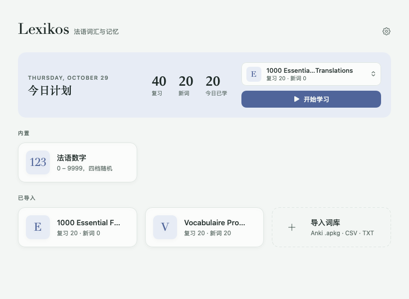

<p align="center"></p>

<h1 align="center">Lexikos</h1>

<p align="center">
A quiet macOS app for learning French vocabulary — flashcards, spaced repetition and forgetting curves.<br>
一款安静的 macOS 法语背词软件：闪卡、间隔复习与遗忘曲线。
</p>

<p align="center"><a href="../../releases/latest">Download for macOS</a> · macOS 14+ · Apple silicon & Intel</p>



*Lexikos* comes from Greek λεξικός, "of words" — the root of *lexicon*. The icon: an open book with a word rising from it, circled by the orbit of review.

---

## 中文

### 它能做什么

- **看数字，说法语**：内置法语数字练习，0–9999 分四档随机（0–10、11–99、100–999、1000–9999）。点一下显示法语写法和国际音标，例如 `71 → soixante et onze /swa.sɑ̃.te.ɔ̃z/`。
- **导入任何词库**：支持 Anki `.apkg` 和 CSV / TSV / TXT。导入时按 Anki 的字段名和卡片模板识别每个字段的含义（单词、意思、词性、音标、例句与翻译），不依赖字段顺序；编号、音频等字段会自动略过。
- **先看要点，细节按需展开**：卡片只显示单词和一行核心意思。长篇说明收进可展开的面板，分为「例句 / 用法说明 / 常用表达 / 相关词汇 / 语法」，每句法语例句下面配翻译。
- **朗读**：翻开时自动朗读，可单独朗读每个例句（只读法语，不读翻译）；慢速模式把语音放慢到一半且不变调。
- **间隔复习**：每张卡评「没记住 / 模糊 / 记住了」，按钮上直接显示下次复习的时间。新词第一次出现时直接展示答案、记为学习中，几张卡后再出现一次检验。
- **每日计划**：每天 = 到期复习 + 一定数量的新词（5 / 10 / 20 / 30 / 50 或自定义）。主页选好词库就能直接开始。
- **遗忘曲线**：每个词库有统计面板——你的平均记忆曲线与艾宾浩斯原始数据对比、未来 14 天复习量、按记忆保留率排序的单词列表；点任一单词可看它自己的锯齿形遗忘曲线和完整复习记录。
- **界面**：中文 / English / Français 三种界面语言，日间 / 夜间 / 跟随系统，六种主题色；窗口大小自适应。

### 复习算法

每张卡有一个「记忆强度」S（天）。记忆保留率按幂函数遗忘曲线 R(t) = 1 / (1 + t / 9S) 计算，因此 S 恰好是记忆降到 90% 所需的天数，复习就安排在那时。

| 评分 | 新词 | 复习时 |
| --- | --- | --- |
| 没记住 | S = 0.3 天 | S × 0.3（最低 0.3 天） |
| 模糊 | S = 1 天 | S × (1.1 + 2 × (1 − R)) |
| 记住了 | S = 2.5 天 | S × (1.5 + 8 × (1 − R)) |

连续「记住了」时间隔大约是 2.5 → 6 → 13 → 30 → 70 天；越接近遗忘时复习，强度增长越多。S ≥ 21 天算「已掌握」。

### 安装

从 [Releases](../../releases/latest) 下载 `Lexikos-<版本>.dmg`，打开后把 Lexikos 拖进「应用程序」。

### 快捷键

| 键 | 作用 |
| --- | --- |
| 空格 / 回车 | 显示答案 / 下一张 / 认识了继续 |
| 1 · 2 · 3 | 没记住 · 模糊 · 记住了 |
| D | 展开 / 收起说明 |
| S · A | 朗读 · 慢速朗读 |
| → | 跳过 |
| Esc | 返回 |

### 数据与隐私

所有内容都保存在本机 `~/Library/Application Support/Lexikos/`（`decks/` 词库、`progress/` 学习记录），不上传任何数据。唯一的联网是检查更新：最多每 12 小时向 GitHub 查询一次最新版本，可在设置里关闭。词库右键「重新导入」可以更新内容并保留学习进度。

### 自动更新

有新版本时主页顶部会出现提示，点「更新并重启」即可。更新包会先校验是否由同一开发者（Developer ID，团队 BGM8P5U985）签名，校验不通过就不会安装。请先把 Lexikos 放进「应用程序」文件夹再更新。

---

## English

### What it does

- **French numbers**: built-in drill from 0 to 9999 in four levels. Click to reveal the spelling and IPA, e.g. `71 → soixante et onze /swa.sɑ̃.te.ɔ̃z/`.
- **Import any deck**: Anki `.apkg` and CSV / TSV / TXT. Anki fields are mapped by their names and the card template (word, meaning, part of speech, IPA, example sentence + translation), not by position; rank numbers and audio fields are skipped.
- **Essentials first**: a card shows the word and a one-line meaning. Long notes go into a collapsible panel grouped as Examples / Usage / Expressions / Related / Grammar, each French sentence with its translation underneath.
- **Speech**: speaks when a card is revealed; each example can be played on its own (French only). Slow mode halves the speed without lowering the pitch.
- **Spaced repetition**: rate each card Forgot / Vague / Knew it; each button shows when the card will return. New words are first shown with their answer, then tested again a few cards later.
- **Daily plan**: due reviews plus a daily number of new words (5–50 or custom). Pick a deck on the home page and start.
- **Forgetting curves**: per-deck statistics — your average retention against Ebbinghaus's 1885 data, a 14-day review forecast, and a word list sorted by recall; click a word for its own saw-tooth curve and review history.
- **Interface**: Chinese / English / French UI, light / dark / system appearance, six accent colours, adapts to window size.

### Scheduling

Each card has a stability S in days. Recall follows a power forgetting curve R(t) = 1 / (1 + t / 9S), so S is exactly the time until recall falls to 90 %, which is when the card is due. See the table above for how each rating updates S; consecutive "Knew it" gives intervals of roughly 2.5 → 6 → 13 → 30 → 70 days. Cards with S ≥ 21 days count as mastered.

### Install

Download `Lexikos-<version>.dmg` from [Releases](../../releases/latest), open it and drag Lexikos into Applications.

### Build from source

Requires Xcode 16 or later (Swift 5.9+), macOS 14+.

```sh
./bundle.sh            # build/Lexikos.app for this Mac, ad-hoc signed
./bundle.sh release    # universal, Developer ID signed, hardened runtime
./release.sh           # signed + notarized dmg in dist/
```

`release.sh` notarizes with the keychain profile named in `NOTARY_PROFILE` (default `lexikos-notary`), created with `xcrun notarytool store-credentials`.

### Data & privacy

Everything stays on your Mac in `~/Library/Application Support/Lexikos/` (`decks/`, `progress/`). No accounts, no telemetry. The only network request is the update check against GitHub Releases, at most every 12 hours; it can be turned off in Settings.

### Updates

When a newer release exists, a banner on the home page offers *Update & restart*. The downloaded app is installed only if its code signature is valid and from the same Developer ID team (BGM8P5U985).

### Project layout

| File | Purpose |
| --- | --- |
| `FrenchNumbers.swift` | Spelling and IPA for 0–9999 |
| `AnkiImport.swift`, `Decks.swift` | Anki / CSV import, deck storage |
| `CardLayout.swift` | Splits a card into answer, tag and categorised notes |
| `Memory.swift` | Forgetting curve, scheduler, daily plan |
| `Speaker.swift` | Speech with real slow-down (time-stretch) |
| `PracticeView.swift`, `OverviewView.swift`, `LexikosApp.swift` | Study, statistics and home screens |
| `Theme.swift` | Palette, accents and UI strings (zh / en / fr) |
| `Updater.swift` | Update check, download, signature check and install |
| `scripts/make-icon.swift` | Draws the app icon |

## License

[MIT](LICENSE)
